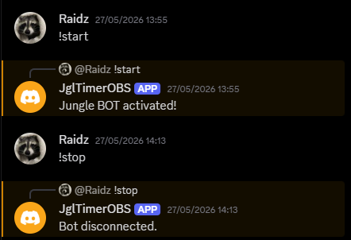

# wwm-jungle-bot

Bot de Discord hecho con Node.js que funciona como temporizador de audio para el modo **Guild vs Guild** de *Where Winds Meet*. En este modo, mobs y bosses aparecen cada cierto tiempo, y el bot reproduce en la llamada de voz avisos como "jungle en 30 s" o "boss en 15 s" para que el equipo los tenga en cuenta sin quitar la vista del juego.

## Comandos
- `!start`: el bot entra en tu canal de voz y reproduce el audio con los avisos hasta que termina.
- `!stop`: el bot sale de la llamada antes de que termine el audio.

## Tecnologías
Node.js, discord.js, @discordjs/voice, ffmpeg-static, dotenv

## Cómo ejecutarlo
1. Clona el repositorio.
2. Instala las dependencias: `npm install`
3. Copia `.env.example` a `.env` y añade el token de tu bot de Discord.
4. Coloca en la raíz del proyecto tu archivo de audio con los avisos y **renómbralo a `audio.mp3`** (no se incluye en el repositorio).
5. Arranca el bot: `node index.js`
6. Métete en un canal de voz y escribe `!start` en su chat.

## Capturas
